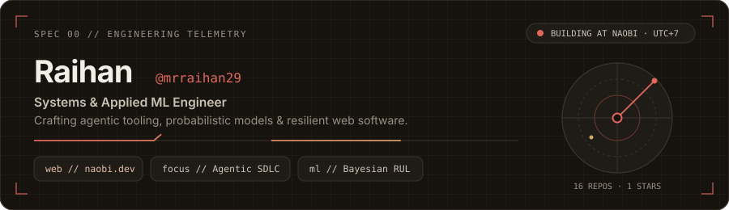
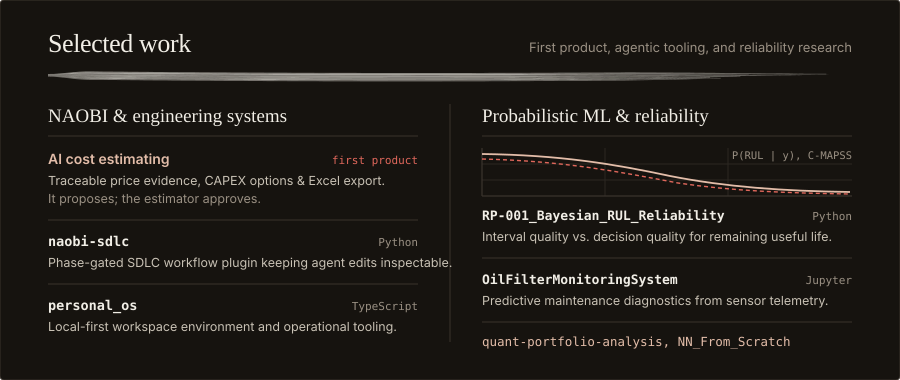
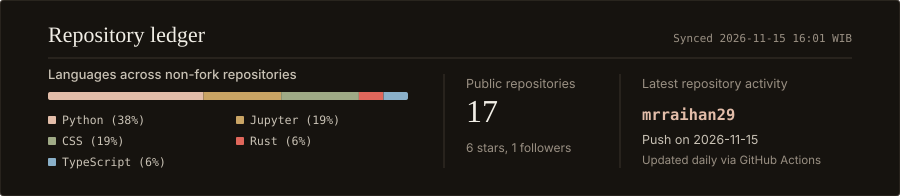
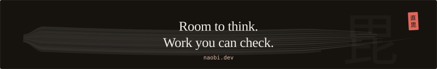

  <a href="https://naobi.dev">
    <picture>
      <source media="(prefers-color-scheme: dark)" srcset="assets/hero-dark.svg" />
      <source media="(prefers-color-scheme: light)" srcset="assets/hero-light.svg" />
      
    </picture>
  </a>

  <a href="https://naobi.dev">naobi.dev</a> &nbsp;&nbsp;|&nbsp;&nbsp;
  <a href="https://naobi.dev/work/">Work</a> &nbsp;&nbsp;|&nbsp;&nbsp;
  <a href="https://www.linkedin.com/in/mrraihan/">LinkedIn</a> &nbsp;&nbsp;|&nbsp;&nbsp;
  <a href="https://instagram.com/mrraihan29">Instagram</a>

  <picture>
    <source media="(prefers-color-scheme: dark)" srcset="assets/folio-dark.svg" />
    <source media="(prefers-color-scheme: light)" srcset="assets/folio-light.svg" />
    
  </picture>

  <a href="https://github.com/mrraihan29/naobi-sdlc"><code>naobi-sdlc</code></a> &nbsp;
  <a href="https://github.com/mrraihan29/personal_os"><code>personal_os</code></a> &nbsp;
  <a href="https://github.com/mrraihan29/RP-001_Bayesian_RUL_Reliability"><code>Bayesian_RUL</code></a> &nbsp;
  <a href="https://github.com/mrraihan29/OilFilterMonitoringSystem"><code>OilFilterMonitoring</code></a> &nbsp;
  <a href="https://github.com/mrraihan29/quant-portfolio-analysis"><code>quant-portfolio</code></a> &nbsp;
  <a href="https://github.com/mrraihan29/NN_From_Scratch"><code>NN_From_Scratch</code></a>

  <picture>
    <source media="(prefers-color-scheme: dark)" srcset="assets/ledger-dark.svg" />
    <source media="(prefers-color-scheme: light)" srcset="assets/ledger-light.svg" />
    
  </picture>

  <a href="https://naobi.dev/contact/">
    <picture>
      <source media="(prefers-color-scheme: dark)" srcset="assets/closing-dark.svg" />
      <source media="(prefers-color-scheme: light)" srcset="assets/closing-light.svg" />
      
    </picture>
  </a>

