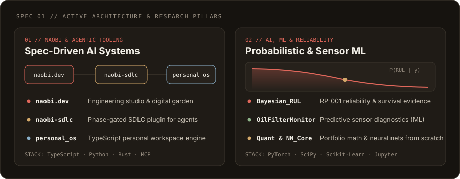
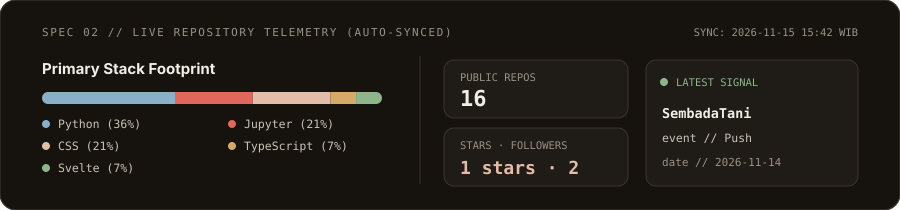

  <a href="https://naobi.dev">
    <picture>
      <source media="(prefers-color-scheme: dark)" srcset="assets/hero-dark.svg" />
      <source media="(prefers-color-scheme: light)" srcset="assets/hero-light.svg" />
      
    </picture>
  </a>

  
  
  

  <picture>
    <source media="(prefers-color-scheme: dark)" srcset="assets/blueprint-dark.svg" />
    <source media="(prefers-color-scheme: light)" srcset="assets/blueprint-light.svg" />
    
  </picture>

  <strong>Pinned Coordinates</strong> 
  <a href="https://naobi.dev"><code>naobi.dev</code></a> ·
  <a href="https://github.com/mrraihan29/naobi-sdlc"><code>naobi-sdlc</code></a> ·
  <a href="https://github.com/mrraihan29/personal_os"><code>personal_os</code></a> ·
  <a href="https://github.com/mrraihan29/RP-001_Bayesian_RUL_Reliability"><code>Bayesian_RUL</code></a> ·
  <a href="https://github.com/mrraihan29/OilFilterMonitoringSystem"><code>OilFilterMonitoring</code></a> ·
  <a href="https://github.com/mrraihan29/quant-portfolio-analysis"><code>quant-portfolio</code></a> ·
  <a href="https://github.com/mrraihan29/NN_From_Scratch"><code>NN_From_Scratch</code></a>

  <picture>
    <source media="(prefers-color-scheme: dark)" srcset="assets/telemetry-dark.svg" />
    <source media="(prefers-color-scheme: light)" srcset="assets/telemetry-light.svg" />
    
  </picture>

  
    Designing spec-driven agent workflows at <a href="https://naobi.dev">NAOBI</a> &amp; exploring probabilistic reliability models. 
    Telemetry cards auto-refresh daily via GitHub Actions in native dark/light ink.
  

